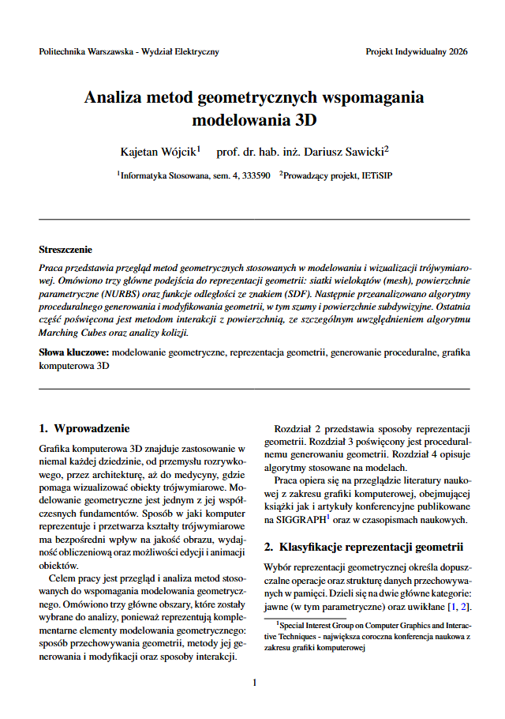

# Analiza metod geometrycznych wspomagania modelowania 3D
*(Geometric Methods in 3D Modeling)*

A technical survey on mathematical representations, procedural generation, and spatial algorithms in 3D computer graphics, Warsaw University of Technology, 2026.

**Note:** The paper is written in **Polish**. 

The compiled document is available directly in this repository: **[paper.pdf](paper.pdf)**.

  
   
  <em>(Click the preview to open the full PDF)</em>

---

## Overview

A literature review on 3D geometry representations, procedural generation methods, and related spatial algorithms based on SIGGRAPH papers and standard computer graphics literature.

### Topics covered:
* **Representations:** Triangle meshes (Indexed Face Sets vs. Half-Edge and Winged-Edge structures, topological 2-manifolds), NURBS (B-splines, knot vectors, projective weights), and Signed Distance Functions (SDFs, voxel grids, octrees, CSG operations).
* **Procedural generation:** Subdivision surfaces (Catmull-Clark for quads, Loop for triangles, limit surface continuity) and gradient noise (Perlin, Improved Perlin, Simplex, Worley).
* **Algorithms:** Marching Cubes (isosurface extraction from scalar fields, 15 canonical patterns, Transvoxel transitions) and SDF-based collision detection (broad-phase vs. narrow-phase, surface normal estimation via gradients).

---

*The complete LaTeX source and figures are located in the [`src/`](src/) folder.*
